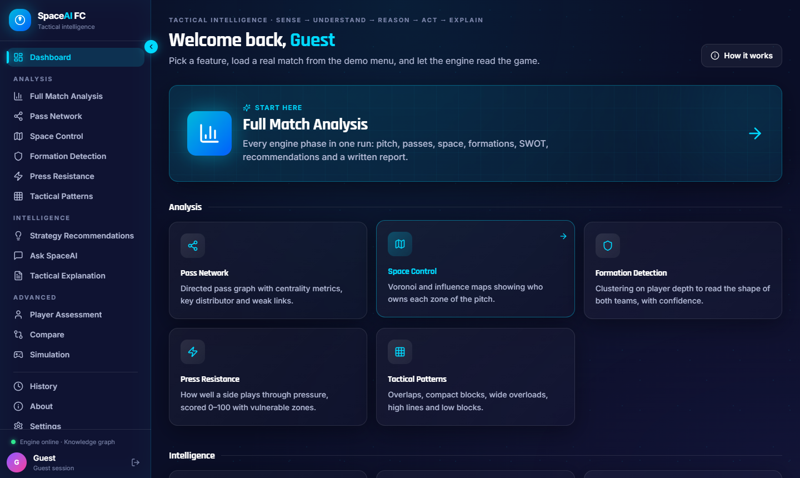
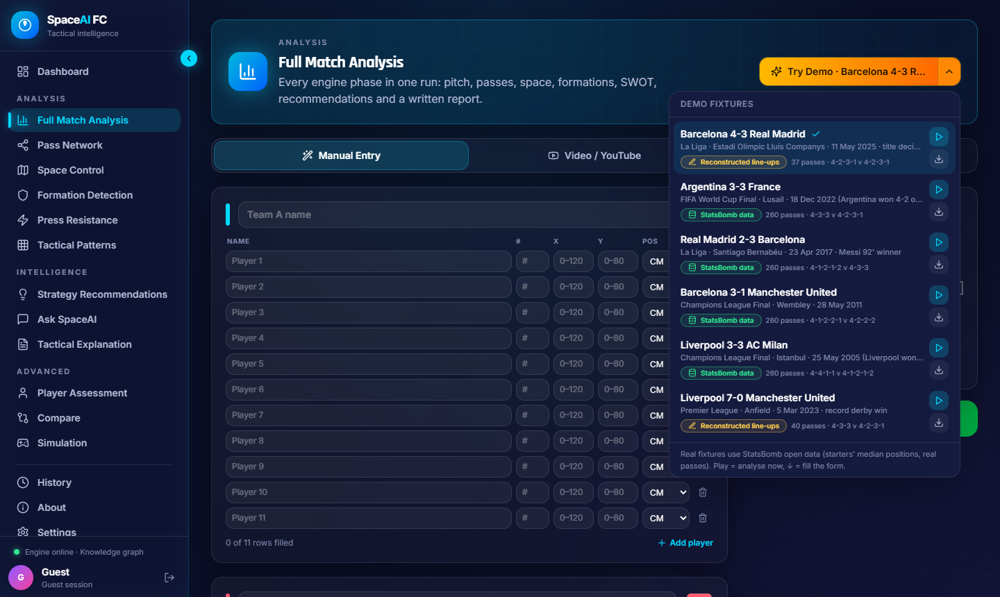
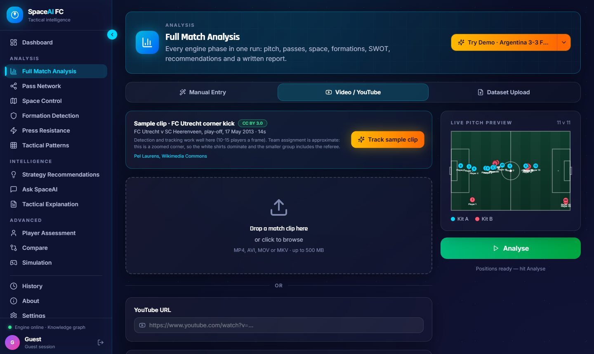
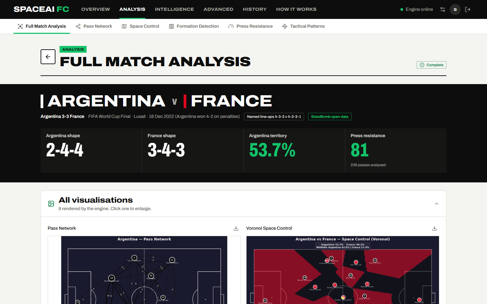
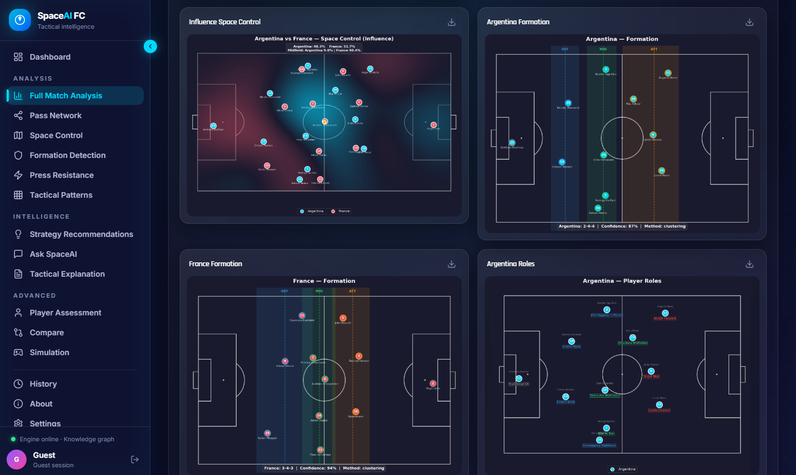
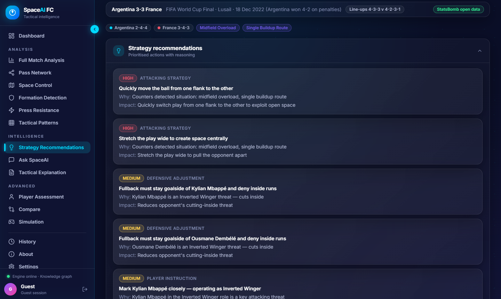
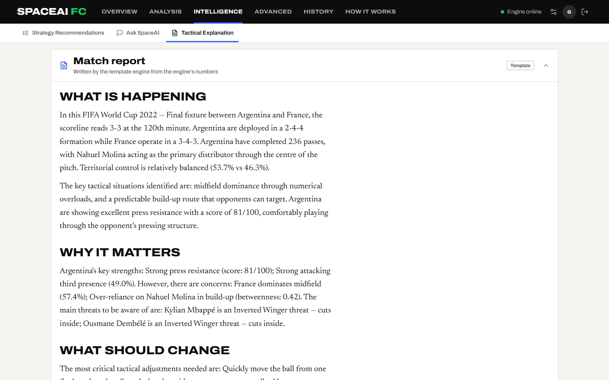
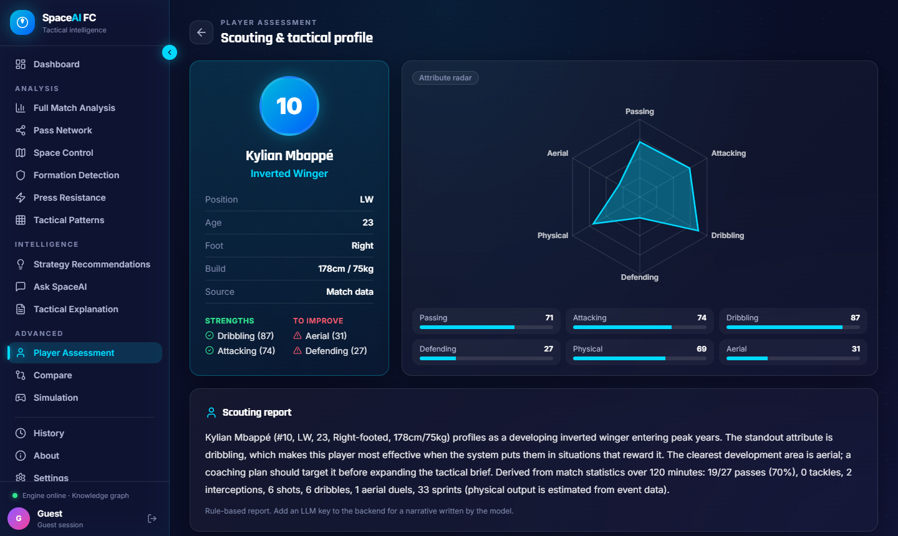
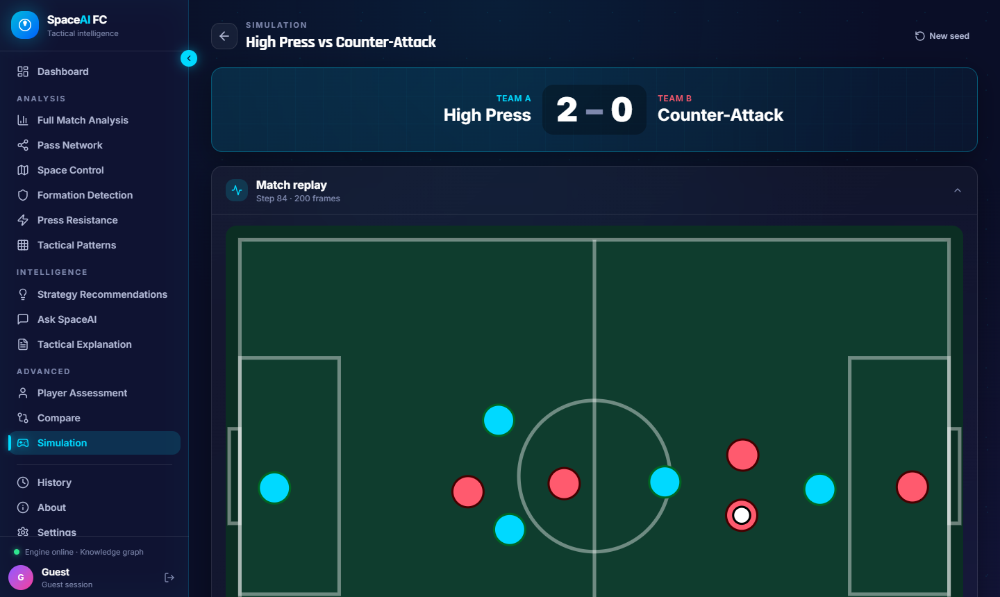

# ⚽ SpaceAI FC

**Agentic tactical intelligence for football.** SpaceAI FC reads a match situation, understands its
tactical structure, reasons about strengths and weaknesses, recommends what to change, and explains its
thinking in the language a coaching staff uses.

It is a four-phase Python engine wrapped in a **FastAPI** backend and a **React + TypeScript** frontend,
built around a robotics-inspired loop: **Sense → Understand → Reason → Act → Explain**.



- **12 features** covering passing, space, shape, pressing, patterns, strategy, scouting and simulation
- **Real match demos** built from StatsBomb open data: one click analyses the 2022 World Cup final
- **Three input methods**: manual entry, video (YOLOv8 tracking) and CSV/JSON datasets
- **No API key or account needed** to run: a tactical knowledge graph answers when no LLM is configured,
  and the app runs in guest mode without Supabase

---

## How it works

Every feature is a slice of the same five-step pipeline. The screenshots below follow one real match,
Argentina 3-3 France in the 2022 World Cup final, through each step.

### 1. Sense — pick a match, or bring your own data

Load a real fixture from the demo menu, type positions in by hand, upload a dataset, or hand the engine
video footage.



Video goes through a real computer-vision pipeline: YOLOv8 detects players, a tracker follows them across
frames, shirts are clustered into two teams, and positions are mapped onto the pitch. A licensed sample
clip is bundled so this can be tried without footage.



### 2. Understand — structure, space and passing

The engine detects each side's shape, measures territorial control with Voronoi and influence models,
builds a directed pass network, and scores press resistance.



Detected shapes are *average* shapes over the match, so they can differ from the named line-up. Argentina
read as 2-4-4 here because their full-backs spent the final in midfield; the UI shows both.



### 3. Reason and 4. Act — what matters, and what to change

A 30-node tactical knowledge graph and a SWOT rule engine identify the situations in play, here a
midfield overload and a single build-up route, then rank concrete adjustments by priority with the
reasoning behind each.



### 5. Explain — a report a coach would read

Everything is written up as a match report. The template engine works offline; with an OpenRouter or
Anthropic key, a language model writes the narrative instead.



### Beyond the match

**Player Assessment** builds an attribute radar, infers the best role and writes a scouting report. Demo
players use real stat lines counted from StatsBomb events, normalised per 90 minutes.



**Simulation** plays two tactical presets against each other in a multi-agent small-sided match, with an
animated replay. **Compare** runs two match-ups several times and reports which setup comes out ahead.



---

## Features

| Feature | What it does |
|---|---|
| **Full Match Analysis** | Every engine phase in one run: visualisations, SWOT, recommendations and a written report |
| **Pass Network** | Directed pass graph with degree, betweenness and eigenvector centrality, key distributor and weak links |
| **Space Control** | Voronoi and Gaussian influence maps with zone-by-zone and midfield control |
| **Formation Detection** | Clustering on player depth to read each side's shape, with confidence |
| **Press Resistance** | Scores 0–100 how well a side plays through pressure, and flags vulnerable zones |
| **Tactical Patterns** | Overlaps, compact blocks, wide overloads, high lines and low blocks |
| **Strategy Recommendations** | Prioritised adjustments reasoned from SWOT and the knowledge graph |
| **Tactical Explanation** | Natural-language match report, template or LLM |
| **Ask SpaceAI** | Tactical Q&A, grounded in your last analysis when one exists |
| **Player Assessment** | Attribute radar, best role and scouting report from stats, ratings or video |
| **Compare** | Two tactical match-ups simulated side by side |
| **Simulation** | Multi-agent 5v5 / 7v7 match with an animated replay |

Every feature has a **Try Demo** button. Results can be exported as PNG, a Word report or a PDF summary.

### Demo fixtures

| Match | Source |
|---|---|
| Argentina 3-3 France · 2022 World Cup final | StatsBomb open data |
| Real Madrid 2-3 Barcelona · 23 Apr 2017, Messi 92' | StatsBomb open data |
| Barcelona 3-1 Manchester United · 2011 Champions League final | StatsBomb open data |
| Liverpool 3-3 AC Milan · 2005 Champions League final | StatsBomb open data |
| Barcelona 4-3 Real Madrid · 11 May 2025 | Reconstructed line-ups |
| Liverpool 7-0 Manchester United · 5 Mar 2023 | Reconstructed line-ups |

For StatsBomb fixtures, each starter's position is their median event location and the passes are the
real events. The two recent matches have no public event data, so they use the real line-ups and score
with synthesised passes, and are labelled "reconstructed" wherever they appear. Player Assessment offers
ten real stat lines from the same matches.

### Input methods

| Method | How it works |
|---|---|
| **Manual entry** | Positions, passes and match info in a validated form with a live pitch preview |
| **Video / YouTube** | YOLOv8 detection and tracking, automatic team clustering, letterbox cropping. Falls back to a clearly labelled synthetic snapshot if the vision packages are not installed |
| **Dataset upload** | CSV or JSON, parsed server-side with clear errors. Templates can be downloaded from the app |

---

## Quick start

```bash
git clone https://github.com/Yassin-Youssef/SpaceAI-fc.git
cd SpaceAI-fc
python -m venv .venv && .venv/Scripts/pip install -r requirements.txt   # Windows
# python -m venv .venv && .venv/bin/pip install -r requirements.txt     # macOS / Linux
```

Start the API, then the frontend, in two terminals:

```bash
.venv/Scripts/python -m uvicorn api.main:app --reload --port 8000
```

```bash
cd frontend && npm install && npm run dev
```

Open **http://localhost:5173** and choose **Continue as guest**. API docs are at http://localhost:8000/docs.

<details>
<summary><b>Optional extras</b>: video analysis, RL coach, LLM answers, accounts</summary>

**Video analysis and RL coach**

```bash
.venv/Scripts/pip install ultralytics opencv-python yt-dlp   # video
.venv/Scripts/pip install gymnasium stable-baselines3         # RL coach
```

ffmpeg is not required: YouTube clips are fetched as video-only streams, which is all the vision pipeline
uses. YOLO weights (about 6 MB) download on first use. `GET /api/health` reports which modules are active.

**LLM answers.** Put `OPENROUTER_API_KEY` or `ANTHROPIC_API_KEY` in a `.env` file at the project root.
Without one, Ask SpaceAI answers from the knowledge graph and reports use the template engine.

**Accounts and saved history.** Add `VITE_SUPABASE_URL` and `VITE_SUPABASE_ANON_KEY` to
`frontend/.env.local`. The SQL for the `analyses` table is in [CLAUDE.md](CLAUDE.md).

**Checks**

```bash
python test_api.py                        # every endpoint, with the server running
cd frontend && npm run typecheck          # TypeScript
```

</details>

---

## Architecture

```
React frontend (Vite, port 5173)
        │  HTTP / JSON
FastAPI backend (port 8000) · 30 endpoints · validation · rate limiting
        │
Engine
  Phase 1  Sense        pitch model, pass networks, space control
  Phase 2  Understand   formations, player roles, press resistance, tactical patterns
  Phase 3  Reason → Act → Explain
                        knowledge graph, SWOT reasoning, recommendations, explanations
  Phase 4  Advanced     video tracking (YOLOv8), RL coach (PPO), multi-agent simulation
```

The engine modules are stateless: each takes data in and returns results, and `main.py` or the API
threads them together. A single resolver turns manual, video and dataset inputs into the same player
format, so every feature accepts all three.

<details>
<summary><b>Engine modules</b></summary>

| Phase | Module | Purpose |
|---|---|---|
| 1 | `engine/analysis/pass_network.py` | Directed NetworkX pass graph and centrality |
| 1 | `engine/analysis/space_control.py` | Voronoi tessellation and Gaussian influence control |
| 2 | `engine/analysis/formation_detection.py` | K-Means and agglomerative clustering, scored by tactical plausibility |
| 2 | `engine/analysis/role_classifier.py` | Rule-based sub-roles: false nine, inverted winger, box-to-box and more |
| 2 | `engine/analysis/press_resistance.py` | Press resistance score and vulnerable zones |
| 2 | `engine/analysis/pattern_detection.py` | Overlaps, compact blocks, overloads, high and low lines |
| 3 | `engine/intelligence/knowledge_graph.py` | Formations, situations, strategies and their relationships |
| 3 | `engine/intelligence/tactical_reasoning.py` | SWOT rule engine over the knowledge graph |
| 3 | `engine/intelligence/strategy_recommender.py` | Prioritised recommendations across five categories |
| 3 | `engine/intelligence/explanation_layer.py` | Template or LLM match reports |
| 4 | `engine/perception/video_analyzer.py` | YOLOv8 detection, tracking, team clustering, pitch mapping |
| 4 | `engine/intelligence/rl_coach.py` | Gymnasium environment and PPO agent over nine tactical decisions |
| 4 | `engine/intelligence/simulation.py` | Rule-based multi-agent 5v5 / 7v7 simulation |
| — | `engine/analysis/match_report.py` | Dashboard, text report and Word export |

</details>

<details>
<summary><b>Project structure</b></summary>

```
SpaceAI-fc/
├── api/                    FastAPI backend
│   ├── routers/            one router per feature, plus dataset and demo
│   ├── services/           engine, LLM and video services
│   ├── models/             Pydantic request and response models
│   └── utils/              input resolver, file handling, image encoding
├── engine/                 the four-phase analysis engine
├── frontend/               React + TypeScript + Tailwind production UI
│   └── src/
│       ├── app/components/ pages, shared primitives, result renderers
│       └── lib/            API client, demo data, motion presets, types
├── data/
│   ├── demo_matches/       bundled real fixtures and player stat lines
│   └── demo_video/         licensed sample clip and its attribution
├── scripts/                build_demo_matches.py (rebuilds fixtures from StatsBomb)
├── docs/screenshots/       images used in this README
├── app/                    legacy Streamlit MVP, still works against the same API
├── main.py                 runs the whole engine end to end
└── test_api.py             integration checks for every endpoint
```

</details>

---

## Tech stack

| Area | Tools |
|---|---|
| Engine | Python, NumPy, pandas, SciPy, NetworkX, scikit-learn, matplotlib, mplsoccer |
| Vision and learning | YOLOv8 (Ultralytics), OpenCV, yt-dlp, Gymnasium, Stable-Baselines3 |
| API | FastAPI, Pydantic, Uvicorn, slowapi, python-docx |
| Frontend | React 18, TypeScript, Vite, Tailwind CSS v4, shadcn/ui, Motion, Recharts |
| Data and AI | StatsBomb open data (statsbombpy), OpenRouter / Anthropic, Supabase |

---

## Limitations

- **Video team assignment is approximate.** Teams are split by shirt colour. On zoomed or close-up
  footage, or when both kits contain white, the split can be lopsided and referees may land on one side.
  Detection and tracking themselves are reliable.
- **Video pitch mapping is a linear stretch** unless reference points are supplied, so coordinates from
  footage are approximate.
- **Reconstructed fixtures use synthesised passes.** Their line-ups and scores are real; their pass
  networks are not.
- **Average positions are not snapshots.** Pattern detection on real fixtures reads calmer than it would on
  a single moment of play.
- **Not deployed yet.** The app runs locally.

---

## Data credits

Demo fixtures and player stat lines are built from [StatsBomb open data](https://github.com/statsbomb/open-data),
used under their free non-commercial licence with attribution. Data © StatsBomb.

The bundled video clip is [*FC Utrecht takes a Corner*](https://commons.wikimedia.org/wiki/File:FC_Utrecht_takes_a_Corner.ogv)
by Pel Laurens, [CC BY 3.0](https://creativecommons.org/licenses/by/3.0/), cropped and re-encoded.
Details are in [`data/demo_video/ATTRIBUTION.md`](data/demo_video/ATTRIBUTION.md).

---

## Author

Built by **Yassin Youssef**. Engine, API and interface.

## License

MIT
